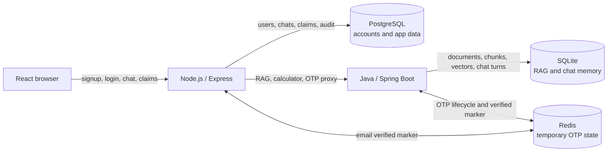
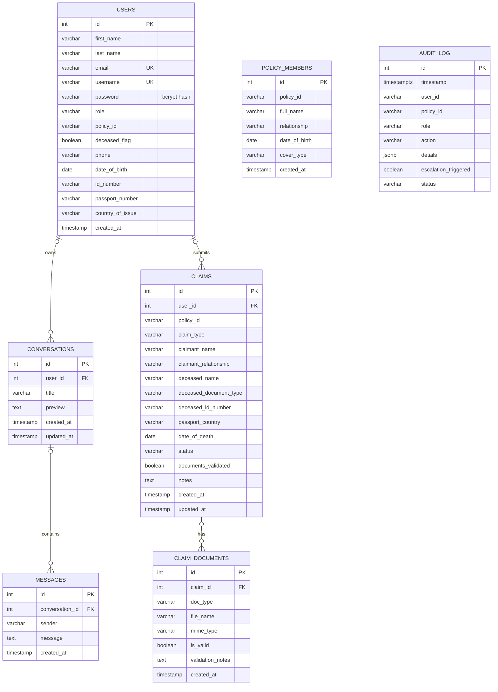

# MediCare AI Companion — Database Diagram and Notes

## What this document covers

This is a source-code-based description of the database design. The application uses more than one store:

1. **PostgreSQL** is used by the Node.js API for accounts, conversations, claims, and audit data.
2. **SQLite** is used by the Java service for the RAG document index and persistent AI conversation memory.
3. **Redis** holds temporary signup email-verification state shared by Node and Java.

The diagrams describe tables and relationships found in the repository. They do not describe live row contents or prove that the hosted PostgreSQL database has exactly the current schema; no live production database connection was inspected for this report.

## Overall data flow



The stores are separate databases. There are no SQL foreign keys across PostgreSQL, SQLite, and Redis; services coordinate them through API calls and shared key conventions.

## PostgreSQL entity relationship diagram



### PostgreSQL tables

| Table | Purpose | Important details |
| --- | --- | --- |
| `users` | Login identity and policyholder/beneficiary profile | `email` and `username` are unique. `password` stores the password hash. `role`, `policy_id`, and `deceased_flag` are used by authorization and policy context. |
| `conversations` | Chat thread metadata | Belongs to a user when `user_id` is present. Stores a title, preview, and timestamps. |
| `messages` | Chat messages shown in a thread | `conversation_id` references `conversations`; deleting a conversation cascades to its messages. |
| `claims` | First Notice of Loss (FNOL) claim records | Includes claimant/deceased details, claim type, status, and document-validation state. |
| `claim_documents` | Per-file claim metadata and validation result | References `claims`; deleting a claim cascades to its document rows. Stores metadata and validation notes, not necessarily the uploaded binary itself. |
| `audit_log` | Append-oriented record of security, AI, and business events | Stores user/policy identifiers, role, action, JSON details, escalation flag, and status. It intentionally has no user foreign key so audit entries can remain after account deletion. |
| `policy_members` | Names and cover details associated with a policy | Created during Node schema initialization. It has a `policy_id` column, but the current schema does not declare a foreign key to `users.policy_id`. |

### PostgreSQL relationships and caveats

- The declared relationships are `users → conversations → messages` and `users → claims → claim_documents`.
- `conversations.user_id`, `messages.conversation_id`, `claims.user_id`, and `claim_documents.claim_id` are references; some are nullable in the SQL definition. The diagram shows the ownership path when those values are populated.
- `policy_members.policy_id` and `users.policy_id` are related by application meaning only. There is no declared database constraint connecting them.
- `claims.policy_id` is stored directly; the schema does not declare it as a foreign key to `users.policy_id` or `policy_members.policy_id`.
- `audit_log.user_id` is a string identity from the session/JWT, not a foreign key to `users.id`.

### PostgreSQL source files

- Table definitions: [`companion-backend-node/database/schema.sql`](companion-backend-node/database/schema.sql)
- Runtime schema additions, including `policy_members`: [`companion-backend-node/database/db.js`](companion-backend-node/database/db.js)
- Account queries: [`companion-backend-node/models/userModel.js`](companion-backend-node/models/userModel.js) and [`companion-backend-node/controllers/authController.js`](companion-backend-node/controllers/authController.js)
- Claim persistence: [`companion-backend-node/controllers/claimsController.js`](companion-backend-node/controllers/claimsController.js)

## SQLite RAG and conversation-memory diagram

```mermaid
erDiagram
    DOCUMENTS ||--o{ CHUNKS : contains
    CHUNKS ||--o| EMBEDDINGS : has

    DOCUMENTS {
        int id PK
        text filename
        text version
        text ingested_at
    }
    CHUNKS {
        int id PK
        int document_id FK
        text section
        text subsection
        text chunk_type
        text content
        text effective_date
        int token_count
        text category
        text created_at
    }
    EMBEDDINGS {
        int chunk_id PK_FK
        text model
        int dims
        blob vector
        text created_at
    }
    CONVERSATION_MESSAGES {
        int id PK
        text conversation_id
        text role
        text content
        text created_at
    }
```

### SQLite tables

| Table | Purpose | Important details |
| --- | --- | --- |
| `documents` | Ingested source-document metadata | A document has a filename, optional version, and ingestion timestamp. |
| `chunks` | Searchable sections split from a source document | Each chunk references a document and stores its section, content, category, type, effective date, and token count. Indexes exist for `section` and `category`. |
| `embeddings` | Vector data associated with a chunk | `chunk_id` is both the primary key and a reference to `chunks.id`, so at most one embedding row is stored per chunk. `vector` is a binary float array, with model and dimension metadata. |
| `conversation_messages` | Persistent RAG chat history | Stores the opaque conversation key, role, message content, and timestamp. It is indexed by `(conversation_id, id)`. This table has no foreign key to PostgreSQL users or conversations. |

The application creates and upgrades this schema on Java startup in [`RagSchemaInitializer.java`](companion-backend/src/main/java/com/candor/companion/rag/RagSchemaInitializer.java). Chunk and vector persistence is handled by [`ChunkRepository.java`](companion-backend/src/main/java/com/candor/companion/rag/ChunkRepository.java); chat history is handled by [`SessionMemoryStore.java`](companion-backend/src/main/java/com/candor/companion/domain/SessionMemoryStore.java).

The SQLite path is configured by `RAG_DB_PATH` and defaults to `policy_rag.db` relative to the Java working directory ([`application.properties`](companion-backend/src/main/resources/application.properties)). The repository currently contains a large local RAG database at [`companion-backend/data/rag.db`](companion-backend/data/rag.db). The active file depends on `RAG_DB_PATH`; the existence of a database file in the repository does not mean every runtime uses that exact path.

## Redis signup verification keys

Redis is a key-value store here, so it does not have relational tables or foreign keys. The email is trimmed and lowercased, then SHA-256 hashed to form a key suffix. Java and Node use the same `signup-email:<purpose>:<email-hash>` namespace.

| Key purpose | Stored value | Expiration / behavior |
| --- | --- | --- |
| `signup-email:send-cooldown:<hash>` | `1` | 60 seconds; limits resend frequency. |
| `signup-email:sends-hour:<hash>` | Counter | 1 hour; at most five send requests per email per hour. |
| `signup-email:code:<hash>` | HMAC-SHA256 digest of email and six-digit code | 5 minutes; the raw code is sent by email and is not stored in Redis. |
| `signup-email:verify-attempts:<hash>` | Counter | 5-minute window; attempts are capped and the code is invalidated after too many failures. |
| `signup-email:verified:<hash>` | `1` | 10 minutes; written after successful verification, required by Node during registration, then deleted after account creation. |

The Java key and OTP logic is in [`EmailOtpService.java`](companion-backend/src/main/java/com/candor/companion/email/EmailOtpService.java). Node checks and consumes the marker in [`requireVerifiedEmail.js`](companion-backend-node/middleware/requireVerifiedEmail.js) and [`authController.js`](companion-backend-node/controllers/authController.js). Node’s Redis connection is configured in [`services/emailOtpService.js`](companion-backend-node/services/emailOtpService.js); Java and Node must use the same Redis database URL.

## Data protection and operational notes

- Do not put live database passwords, Redis credentials, OTP signing secrets, or user data in this document or commit them to source control.
- PostgreSQL account passwords are hashed before storage; OTP codes are stored as an HMAC digest, not as plaintext.
- The RAG SQLite database contains imported policy chunks and embedding vectors. Back it up as a data artifact and avoid committing replacements without checking repository size and Git LFS policy.
- The schema shows the structure, not the actual contents, counts, or health of the hosted PostgreSQL/Redis services.
- Consider adding a formal migration tool and explicit indexes for frequently queried foreign-key columns as the application grows.
