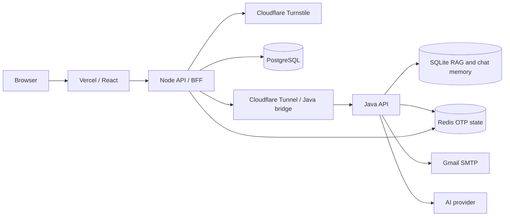

# MediCare AI Companion — Security Guide

## Purpose and security status

This document follows the main requests from browser to service and data store, and records controls visible in the repository. It is a source-code review, not a penetration test or a confirmation of deployed environment settings. The app is a school/demo project and is **not ready to be treated as a production insurance or financial service without the open issues below being resolved**.

Main components:

- React/Vite browser app: [`companion-frontend/src`](companion-frontend/src)
- Node/Express API and PostgreSQL access: [`companion-backend-node`](companion-backend-node)
- Java/Spring Boot RAG, authorization, claims validation, email OTP, and calculations: [`companion-backend/src/main/java/com/candor/companion`](companion-backend/src/main/java/com/candor/companion)
- SQLite RAG and chat-memory database: configured in [`application.properties`](companion-backend/src/main/resources/application.properties)
- Redis signup-verification state: Node [`emailOtpService.js`](companion-backend-node/services/emailOtpService.js) and Java [`EmailOtpService.java`](companion-backend/src/main/java/com/candor/companion/email/EmailOtpService.java)

## Request path at a glance

The browser should only receive public configuration such as the Turnstile site key. Private credentials belong in Node/Java server environments. `VITE_*` values are bundled into browser assets and must be considered public.

## 1. Signup and email verification

### Normal email OTP flow

1. The browser collects the signup fields and requests a code through [`authService.js`](companion-frontend/src/services/authService.js).
2. Node checks the email format and whether an account already uses it in [`emailOtpController.js`](companion-backend-node/controllers/emailOtpController.js).
3. Node proxies the request to Java. Java validates the request in [`EmailOtpController.java`](companion-backend/src/main/java/com/candor/companion/email/EmailOtpController.java).
4. Java generates a six-digit code with `SecureRandom`, stores an HMAC digest (not the plain code), and emails the code through Gmail SMTP. Redis expiry is five minutes. Resends are limited to once per minute and five sends per hour per normalized email; verification attempts are capped at five. A correct code is single-use and creates a ten-minute verified marker.
5. The user enters the code in [`Register.jsx`](companion-frontend/src/pages/Register.jsx). The UI marks it verified only after the server response.
6. The user completes Turnstile. Node calls Cloudflare Siteverify in [`turnstile.js`](companion-backend-node/middleware/turnstile.js).
7. The `/register` route runs `requireVerifiedEmail`, then `verifyTurnstile`, then account creation ([`authRoutes.js`](companion-backend-node/routes/authRoutes.js)). Node checks the marker in Redis, hashes the password with bcrypt, stores the account in PostgreSQL, and deletes the marker ([`authController.js`](companion-backend-node/controllers/authController.js)).

The Redis marker protects account creation from a browser-only verification claim. Node and Java must use the same Redis database URL. Java also needs Gmail credentials and `EMAIL_OTP_HASH_SECRET` configured privately.

### Temporary presentation simulation

`VITE_DEMO_EMAIL_VERIFICATION=true` changes the signup button to **Verify email (demo)** and explicitly says no email was sent. Registration also needs `DEMO_EMAIL_VERIFICATION_BYPASS=true` in the Node server environment; the check is in [`requireVerifiedEmail.js`](companion-backend-node/middleware/requireVerifiedEmail.js). Turnstile remains required.

When the server flag is enabled, **any syntactically valid email can pass the email-verification gate without mailbox ownership**. Keep both flags false/unset for normal use and disable/redeploy them after the presentation. The frontend flag alone does not bypass the server check.

### OTP integration concern to resolve

The current hybrid bridge at [`scripts/hybrid-java-bridge.js`](scripts/hybrid-java-bridge.js) requires a Bearer token for every `/api/**` route. The unauthenticated Node OTP proxy sends no session token when a visitor is registering ([`proxyService.js`](companion-backend-node/services/proxyService.js)); therefore OTP requests sent through this bridge can be rejected before Java receives them. Reconcile this boundary before claiming the hybrid OTP flow works—for example, add a narrowly scoped, server-to-server credential for OTP routes and enforce it at the bridge/Java boundary, with rate limits, instead of making the bridge broadly unauthenticated.

## 2. Login and session lifecycle

1. The browser sends email/password to Node over HTTPS with `credentials: "include"` ([`authService.js`](companion-frontend/src/services/authService.js)).
2. Node compares the submitted password with its bcrypt hash. Login failures are limited to five per email over a 15-minute window in [`loginAttemptLimiter.js`](companion-backend-node/middleware/loginAttemptLimiter.js).
3. On success, Node signs an HS256 JWT with the shared `JWT_SECRET` (or legacy `MOCK_JWT_SIGNING_SECRET`). It uses a 15-minute token lifetime and places it in an HttpOnly cookie. The JWT is not returned to browser JavaScript.
4. In production the cookie is named `__Host-candor_session`, has `Secure`, `HttpOnly`, `SameSite=None`, `Path=/`, and no `Domain` attribute. These settings support the cross-site Vercel/Render deployment. In local development, the cookie uses `candor_session`, is not Secure, and uses `SameSite=Lax` ([`sessionCookie.js`](companion-backend-node/middleware/sessionCookie.js)).
5. Protected Node routes validate the JWT signature, issuer, audience, and expiry ([`auth.js`](companion-backend-node/middleware/auth.js)). The refresh endpoint can extend the session up to 30 days from the original authentication time ([`authController.js`](companion-backend-node/controllers/authController.js)). Logout clears the cookie.

The Node server refuses to start if the JWT secret is missing or shorter than 32 bytes ([`server.js`](companion-backend-node/server.js)). The same signing secret must be available to Java so Java can independently validate the forwarded token. Rotate secrets through server configuration; do not place them in frontend variables or commit them.

## 3. Browser-to-Node request protections

- **Origin/CORS:** Node allows configured exact origins and credentialed CORS; production requires `FRONTEND_ORIGINS` ([`csrf.js`](companion-backend-node/middleware/csrf.js), [`server.js`](companion-backend-node/server.js)).
- **CSRF check:** for non-GET/HEAD/OPTIONS requests, the middleware requires an `Origin` header that exactly matches its allowlist. This is an Origin allowlist check, not a synchronizer CSRF token. Ensure production origins are exact and current.
- **Request size:** JSON bodies are capped at 1 MiB in `server.js`.
- **Response headers:** Node disables `X-Powered-By`, sets `X-Content-Type-Options: nosniff` and a Referrer Policy, and adds HSTS in production. A Content Security Policy and explicit frame-embedding policy are not set in the inspected code.
- **Turnstile response:** Node requires a successful Siteverify response, but the inspected middleware does not additionally compare the returned hostname/action to expected values.
- **Cookie consent:** the frontend checks local consent before its shared API helper sends credentialed requests ([`api.js`](companion-frontend/src/services/api.js)). This is a client privacy gate, not authentication; Node independently validates sessions.

## 4. Node authorization and ownership checks

Node authenticates protected routes and applies role checks in [`requireRole.js`](companion-backend-node/middleware/requireRole.js): policyholders and beneficiaries can use read-oriented chat/RAG/claims routes; what-if and self-service mutations are policyholder-only and blocked when the JWT marks the account deceased. Route configuration is in [`ragRoutes.js`](companion-backend-node/routes/ragRoutes.js), [`claimsRoutes.js`](companion-backend-node/routes/claimsRoutes.js), [`whatIfRoutes.js`](companion-backend-node/routes/whatIfRoutes.js), and [`selfServiceRoutes.js`](companion-backend-node/routes/selfServiceRoutes.js).

### High-priority ownership gap

Several chat persistence endpoints authenticate the caller but do not consistently bind the requested record to that caller:

- `GET /api/chat/conversations/:userId` uses the supplied path user ID.
- `POST /api/chat/conversations` accepts `user_id` from the request body.
- Message read/save endpoints use a conversation ID without checking that the conversation belongs to the signed-in user.
- Conversation deletion does check ownership in SQL.

The routes are in [`chatRoutes.js`](companion-backend-node/routes/chatRoutes.js); the relevant query/controller behavior is in [`chatController.js`](companion-backend-node/controllers/chatController.js) and [`db.js`](companion-backend-node/database/db.js). Before handling real private data, derive the user ID only from the verified JWT and enforce conversation ownership for every read, create, save, and delete operation.

Claims queries scope records to the signed-in user in [`claimsController.js`](companion-backend-node/controllers/claimsController.js). Claim file uploads have a 10 MiB limit and a MIME allowlist in [`claimsRoutes.js`](companion-backend-node/routes/claimsRoutes.js), but client-supplied MIME types are not proof of file contents. The self-service multipart route has a 10 MiB limit but no equivalent MIME allowlist in [`selfServiceRoutes.js`](companion-backend-node/routes/selfServiceRoutes.js). Add content inspection, safe file handling, and malware scanning before production uploads.

The frontend requires passwords to be at least eight characters, but the inspected Node registration controller does not enforce that policy itself. Repeat all security-relevant input checks on the server so direct API calls cannot bypass browser validation.

## 5. Node-to-Java and Java authorization

Node proxies approved Java requests and forwards the validated JWT as a Bearer token ([`proxyService.js`](companion-backend-node/services/proxyService.js)). In the hybrid setup, the tunnel targets the loopback-only bridge ([`hybrid-java-bridge.js`](scripts/hybrid-java-bridge.js)); the bridge accepts API methods, requires a Bearer token, and blocks `/api/dev/**`.

Java verifies the JWT signature, issuer, audience, and expiration in [`MockJwtService.java`](companion-backend/src/main/java/com/candor/companion/security/MockJwtService.java) and applies endpoint roles in [`SecurityConfig.java`](companion-backend/src/main/java/com/candor/companion/security/SecurityConfig.java). The `JwtAuthenticationFilter` derives an effective role and deceased status via [`ProfileStore.java`](companion-backend/src/main/java/com/candor/companion/domain/ProfileStore.java). The profile store is currently in-memory/demo data, not a live PostgreSQL authority.

### Development token endpoint warning

Java permits `/api/dev/**` without authentication in [`SecurityConfig.java`](companion-backend/src/main/java/com/candor/companion/security/SecurityConfig.java). The hybrid bridge blocks those paths, but a Java service exposed directly on a public host may expose them unless separately disabled or network-restricted. Do not expose the Java app directly with this development token route enabled.

## 6. RAG, AI provider, and policy-answer safety

1. The browser sends chat/query requests to Node; Node requires a valid session and allowed role.
2. Node forwards the token and request to Java.
3. Java retrieves chunks from SQLite and builds a system prompt with context-only, no-guarantee, and claims-mode rules ([`RagRetrievalService.java`](companion-backend/src/main/java/com/candor/companion/rag/RagRetrievalService.java), [`CompliancePromptBuilder.java`](companion-backend/src/main/java/com/candor/companion/rag/CompliancePromptBuilder.java)).
4. Java calls a configured AI provider. API keys are loaded from Java server settings, not browser code.
5. Java applies a response guardrail for guarantee language and monetary-value framing and records a structured application log when it fires ([`ComplianceGuardrailService.java`](companion-backend/src/main/java/com/candor/companion/rag/ComplianceGuardrailService.java), [`AuditLoggerService.java`](companion-backend/src/main/java/com/candor/companion/domain/AuditLoggerService.java)).
6. The response returns through Node to the browser.

These are defense-in-depth controls, not a guarantee that a language model cannot hallucinate or be manipulated. The RAG context, prompt, and post-response pattern checks should not replace human review for eligibility, coverage decisions, claims approvals, or financial advice. User prompts and retrieved text are model inputs; prompt-injection resistance is not established by the inspected code.

The configured output cap defaults to 1,024 tokens ([`application.properties`](companion-backend/src/main/resources/application.properties)). This reduces oversized requests but does not guarantee provider balance or availability.

## 7. Data storage and privacy

- **PostgreSQL:** account hashes and profile fields, chat threads/messages, claims and claim-document metadata; schema at [`schema.sql`](companion-backend-node/database/schema.sql). SQL calls inspected use parameterized query values in the main persistence paths.
- **SQLite:** policy-document chunks, embedding vectors, and persistent chat history. Chat history is stored under a conversation key and the inspected Java store has no PostgreSQL user foreign key ([`RagSchemaInitializer.java`](companion-backend/src/main/java/com/candor/companion/rag/RagSchemaInitializer.java), [`SessionMemoryStore.java`](companion-backend/src/main/java/com/candor/companion/domain/SessionMemoryStore.java)).
- **Redis:** hashed OTP state and the short-lived verification marker; it is not an account database.
- **Audit:** PostgreSQL has an `audit_log` table, but Java’s `AuditLoggerService` currently writes structured audit events to application logs rather than inserting into that table. Treat log retention/access as a security concern; do not assume a tamper-resistant audit trail.
- **Retention:** no complete retention/deletion policy for chats, claim documents, or application logs was established in this review. Document and implement one before production use.

Avoid logging passwords, full OTPs, access tokens, SMTP credentials, or complete claim documents. Review current logs for question text and personal data before sharing log exports.

## 8. Secrets and configuration

Keep secrets in local ignored `.env` files or deployment secret settings. Example templates are [`companion-backend-node/.env.example`](companion-backend-node/.env.example), [`companion-backend/.env.example`](companion-backend/.env.example), and [`companion-frontend/.env.example`](companion-frontend/.env.example). Example values are placeholders, not usable credentials.

Private server-side values include:

- `JWT_SECRET` / `MOCK_JWT_SIGNING_SECRET` (must match between Node and Java)
- `DATABASE_URL` and database credentials
- `REDIS_URL` (shared by Node and Java for OTP flow)
- `GMAIL_USER`, `GMAIL_PASS`, `EMAIL_OTP_HASH_SECRET` (Java only)
- `TURNSTILE_SECRET_KEY` (Node only)
- `OPENROUTER_API_KEY`, `AI_GATEWAY_VIRTUAL_KEY` (Java only)
- `JAVA_SERVICE_URL` (Node server configuration; use HTTPS in production)

`VITE_TURNSTILE_SITE_KEY` and `VITE_DEMO_EMAIL_VERIFICATION` are public frontend settings. Never prefix a secret with `VITE_`.

The repository seed script [`seed-accounts.js`](companion-backend-node/scripts/seed-accounts.js) contains plaintext demo account passwords. Treat those accounts as test-only, remove or externalize seed credentials before production, and rotate any credentials that were ever used in a reachable environment. Do not copy values from the seed script into reports, screenshots, or public documentation.

## 9. Current risks and recommended order

| Priority | Finding | Recommended action |
| --- | --- | --- |
| Critical | Demo mode can bypass email ownership if enabled on Node. | Keep `DEMO_EMAIL_VERIFICATION_BYPASS` false/unset except for a controlled presentation; remove it immediately after. |
| Critical | Chat records are not consistently checked for ownership. | Bind every conversation and message operation to `req.user.id`; add authorization tests for cross-user access. |
| High | Public Java `/api/dev/**` token-issuing endpoints are only blocked by the hybrid bridge. | Disable them outside local development or put Java behind a private network/authenticated gateway. |
| High | Hybrid bridge requires Bearer auth for OTP routes, but signup OTP proxy requests are unauthenticated. | Add a narrowly scoped server-to-server credential and enforce it for OTP routes; do not open all bridge paths. |
| High | Login throttling is process-memory/per-email only; OTP send throttling is per-email only. | Use shared rate limiting and IP/device controls at the edge/API. |
| High | Database SSL in Node uses `rejectUnauthorized: false` by default when SSL is enabled ([`db.js`](companion-backend-node/database/db.js)). | Configure certificate validation and managed-secret rotation for production DB connections. |
| High | The seed script includes plaintext demo credentials ([`seed-accounts.js`](companion-backend-node/scripts/seed-accounts.js)). | Keep it out of production workflows; remove or load test credentials from a protected local-only source and rotate exposed values. |
| High | Password length is checked in the browser but not comprehensively enforced in the Node registration controller. | Apply server-side password and field validation before hashing or database writes. |
| Medium | Upload MIME checks rely on client metadata; self-service upload route lacks a MIME allowlist. | Inspect actual file signatures, cap all upload paths, scan files, and keep storage private. |
| Medium | No CSP/frame policy or complete data-retention policy was found. | Add restrictive browser security headers and documented retention/deletion controls. |
| Medium | Audit events are application logs, not persisted to the `audit_log` table by the Java logger. | Centralize protected logs or persist append-only audit events with access controls and retention. |

## 10. Safe deployment checklist

- [ ] Turn both demo email-verification flags off for normal use.
- [ ] Configure exact production `FRONTEND_ORIGINS`; do not use wildcard origins with credentials.
- [ ] Use HTTPS end-to-end for browser-to-Node and Node-to-Java; keep local bridge bound to loopback.
- [ ] Keep the Java service behind the bridge/private network and disable public development token routes.
- [ ] Use long random secrets, store them only in server secret settings, and rotate any secret ever pasted into chat or committed.
- [ ] Confirm Node and Java point to the same intended Redis database; confirm code expiry and account registration behavior.
- [ ] Fix chat object ownership checks before storing private conversations.
- [ ] Verify database TLS certificates and restrict database/network access.
- [ ] Test unauthorized, wrong-role, cross-user, CSRF-origin, invalid-Turnstile, invalid/expired-OTP, and upload edge cases.
- [ ] Define data retention and deletion for accounts, chat history, claims metadata/files, and logs.

This guide reflects the current source tree and should be updated whenever authentication, deployment topology, database access, or the demo bypass changes.
